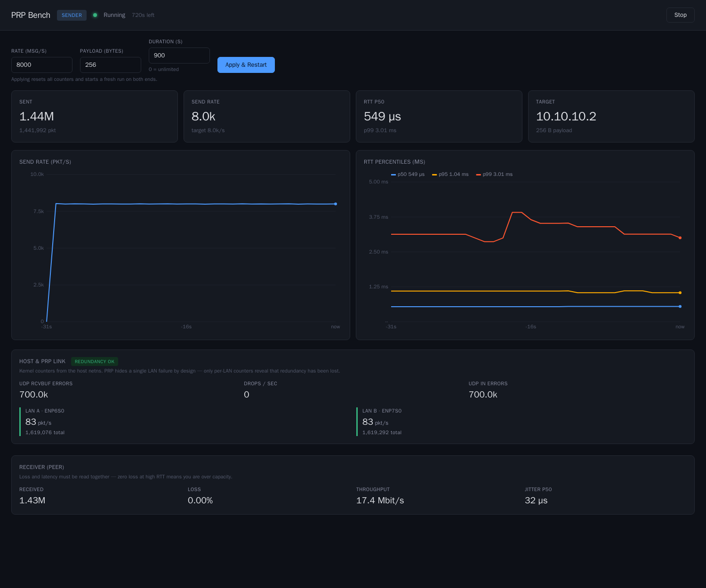
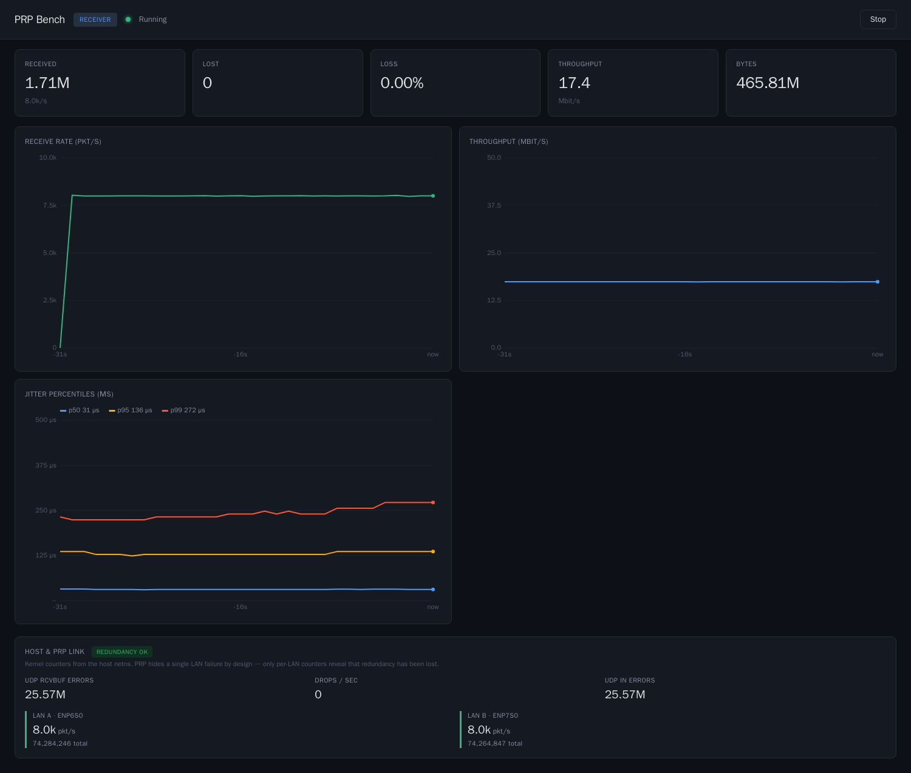

# PRP Bench

[](https://github.com/arthur-r-oliveira/quarkus-prp-bench/actions/workflows/build-push-scan.yml)
[](https://arthur-r-oliveira.github.io/quarkus-prp-bench/)
[](https://quay.io/repository/rhn_support_arolivei/prp-bench?tab=tags)

**Industrial Edge measurement** for PRP/HSR underlays — and a **real Quarkus
proof point** for [Red Hat Hardened Images](https://www.redhat.com/en/blog/red-hat-hardened-images)
([Project Hummingbird](https://www.redhat.com/en/about/press-releases/red-hat-introduces-project-hummingbird-zero-cve-strategies))
plus [Lightwell Network](https://www.redhat.com/en/lightwell).

One artifact, two customer conversations:

| Lens | What you show |
|------|----------------|
| **OT / PRP** | Zero loss, p99.9 latency, jitter, and per-LAN redundancy while a LAN fails silently |
| **Supply chain** | Same workload on legacy UBI vs Hardened Images vs Hardened + Lightwell — scanned side by side |

---

## What this is / is not (OT)

| This **is** | This is **not** |
|-------------|-----------------|
| UDP load + observability over a host PRP netdev (`prp0`) | An **IEC 62439-3** implementation, certification, or conformance suite |
| Proof that silent single-LAN failure is detectable | A GOOSE / SV / OPC-UA simulator (those are motivation / roadmap) |
| OT acceptance criteria: loss, p99.9, jitter, `redundancyOk` | An HSR product showcase — `hsr0` is unverified here |

> PRP Bench does **not** implement or certify IEC 62439-3. It exercises and
> observes a 62439-3 underlay the way OT cares about it: seamless failover stays
> invisible to the app, while we still show when redundancy is gone.

PRP/HSR behaviour lives in the **kernel, NIC, and switch**. This tool sits above
`prp0`, sends paced **unicast UDP**, and reports what protection traffic would
need: **zero loss**, **bounded tails**, **stable jitter**, plus slave LAN
counters — because PRP hides a dead LAN by design.

---

## Architecture

```
   SNO-A (10.10.10.1)                                  SNO-B (10.10.10.2)
  ┌─────────────────────┐                             ┌─────────────────────┐
  │       SENDER        │ ──── UDP data :9200 ──────► │      RECEIVER       │
  │   paced send loop   │ ◄─── UDP ACK  :9201 ─────── │   counts + ACKs     │
  └──────────┬──────────┘                             └──────────┬──────────┘
             │                                                   │
          ┌──┴──┐          LAN A                              ┌──┴──┐
          │prp0 ├─────────────────────────────────────────────┤prp0 │
          │     ├─────────────────────────────────────────────┤     │
          └─────┘          LAN B                              └─────┘
```

Both roles expose HTTP `:8080` (dashboard, `/api/stats`, Prometheus). Pods use
`hostNetwork: true` so they see host `prp0` and kernel counters.

### Demo: silent LAN failure

1. Run paced load — app rate ≈ LAN A ≈ LAN B, `redundancyOk`.
2. Fail one PRP slave.
3. App loss/RTT stay healthy; one LAN **degraded**, `redundancyOk` false.
4. Restore; both LANs track again.

Talk track: [docs/demo-prp-lan-failure.md](docs/demo-prp-lan-failure.md).

### Dashboard





Sender shows rate + RTT and a **Receiver (peer)** panel; receiver shows loss,
throughput, jitter, and **Host & PRP link** (both LANs). Read loss and latency
together — zero loss with multi-second RTT is still an OT failure.

### Why OT criteria differ from IT benchmarks

Protection-style traffic has hard deadlines and no useful retransmission on the
wire. Average throughput is nearly irrelevant. Report **zero loss**, **p99.9**,
and **jitter**; monitor **per-LAN** counters so redundancy loss is visible.
Payload budget on a real PRP link: `payloadBytes ≤ 1452` (RCT). Defaults stay
inside it. Detail: [docs/engineering-notes.md](docs/engineering-notes.md).

---

## Supply chain: Hummingbird, Hardened Images, Lightwell

Same Quarkus uber-jar, four images — only the **base** and the **Maven source**
change. They are **layers, not alternatives**:

| Lever | Owns | What moves in the scan |
|-------|------|-------------------------|
| [Hardened Images](https://images.redhat.com) (Hummingbird) | OS / runtime (`hi/openjdk`) | **grype OS**, image size |
| [Lightwell](https://www.redhat.com/en/lightwell) | App jars | **grype app** — `validated` = provenance (same CVE count); `remediated` + `.rhlw-*` = CVE backports |

```
┌─────────────────────────────────────┐
│  Application deps (uber-jar)        │  ← Lightwell Network
├─────────────────────────────────────┤
│  OS / runtime base                  │  ← Red Hat Hardened Images
└─────────────────────────────────────┘
```

| Tag | Base | Dependencies | Isolates |
|-----|------|--------------|----------|
| `:legacy` | `ubi9/openjdk-17-runtime:1.24` | Maven Central | Control (“before”) |
| `:legacy-lightwell` | `ubi9/openjdk-17-runtime:1.24` | Lightwell `validated` | Lightwell on legacy base |
| `:hardened` | `hi/openjdk:21` | Maven Central | Hardened Images effect |
| `:hardened-lightwell` | `hi/openjdk:21` | Lightwell `validated` | Both layers |

`Containerfile` stays on **UBI9/JDK17** with **`microdnf update`** — current
UBI practice and the old remediation model (`ubi9/openjdk` ships microdnf, not
full dnf). Do not swap this path onto `hi/openjdk` or bump the app JDK: that
destroys the side-by-side with Hardened Images. Hardened variants cannot run
`microdnf`; they move by rebuilding against a newer catalog digest. Bytecode
stays `release=17`; hardened runs on 21.

### Measured results (dated — re-run before quoting)

**2026-10-20**, Quarkus 3.15.1, grype DB 2026-10-20T06:29:49Z:

| Variant | grype total | OS | App |
|---------|-------------|----|-----|
| `legacy` | 779 | 707 | 72 |
| `hardened` | 72 | 0 | 72 |
| `hardened-lightwell` | 72 | 0 | 72 |

(Three tags then; `:legacy-lightwell` completes the matrix now.) Hardened Images
collapsed **OS** findings. App jars were unchanged across bases. Lightwell
**`validated` matched on CVE count** — expected: same versions, SLSA L3
provenance, not patches. In that build ~11% of jars came from Lightwell; the
rest fell back to Central.

**2026-11-05**, Quarkus **3.40.1.1** LTS, grype DB 2026-11-05T06:21:06Z:

| Variant | grype total | OS | App | crit | high |
|---------|-------------|----|-----|------|------|
| `legacy` | 837 | 765 | 72 | 2 | 116 |
| `hardened` | 129 | 129 | **0** | 0 | 4 |

App findings moved with the **platform BOM** (and would move with Lightwell
**`remediated`** + `.rhlw-*` pins). OS “zero” is not permanent — rebuild
hardened tags as the base and vuln DB move.

### Lightwell adoption (honest)

| Repo | What you get | Cost to adopt |
|------|----------------|---------------|
| `validated` | Secure rebuild, provenance | URL / settings change |
| `remediated` | CVE-fixed artifacts | Pin `.rhlw-0000X` in `pom.xml` |
| `predisclosure` | Early fixes | Tier-dependent |

**Do not claim:** `validated` removes CVEs; “zero CVE” for the whole image;
Hardened Images fix the uber-jar; this tool certifies PRP/HSR.

Full talk track: [docs/demo-supply-chain.md](docs/demo-supply-chain.md).  
Customer view: [Quay tags](https://quay.io/repository/rhn_support_arolivei/prp-bench?tab=tags).

```bash
podman build -t prp-bench:legacy   -f Containerfile .
podman build -t prp-bench:hardened -f Containerfile.hardened .
# With Lightwell credentials: also builds :legacy-lightwell and :hardened-lightwell
LW_USER='<org>|<sa>' LW_TOKEN='<token>' tools/scan-images.sh
tools/quay-scan-report.sh   # Clair table for published tags
```

### CI

[Build → Push → Scan → Report](.github/workflows/build-push-scan.yml) on a
self-hosted `prp-bench` runner: builds variants, pushes to Quay, runs
grype/trivy/syft, fetches Quay Clair, writes the run summary, then publishes the
[CI scan dashboard](https://arthur-r-oliveira.github.io/quarkus-prp-bench/)
(history across successful runs). PRs build/scan only. Credentials stay in
Actions secrets or host login / `~/.config/prp-bench/ci.env` — **never in git**.

Rebuild the site locally from harvested artifacts:

```bash
tools/ci-dashboard/harvest-artifacts.sh
python3 tools/ci-dashboard/build.py \
  --artifacts-root target/ci-dashboard-artifacts \
  --out target/ci-dashboard-site
```

Each published run includes a **report pack** (`data/runs/<id>/`) with
`summary.md` / `.json`, Quay summaries, and per-variant grype/trivy JSON.
The Actions `image-scans` artifact still has SBOMs and raw Quay payloads.

---

## Run and deploy

### Local

```bash
PRP_BENCH_MODE=RECEIVER PRP_BENCH_BIND_ADDRESS=127.0.0.1 mvn quarkus:dev
PRP_BENCH_MODE=SENDER PRP_BENCH_TARGET_HOST=127.0.0.1 PRP_BENCH_MESSAGES_PER_SECOND=1000 mvn quarkus:dev
```

### OpenShift (SNO)

Needs `hostNetwork` + `hostnetwork` SCC. Profiles: `k8s/base`,
`k8s/overlays/baremetal`, `k8s/overlays/hardened` (`:hardened` + restrictive
`securityContext`).

```bash
oc apply -f k8s/base/namespace.yaml
oc adm policy add-scc-to-user hostnetwork -z default -n prp-bench
oc apply -f k8s/node-tuning.yaml
oc apply -k k8s/base          # or overlays/baremetal | overlays/hardened
```

Tune rate without restart:

```bash
curl -X POST -H 'Content-Type: application/json' \
  -d '{"messagesPerSecond":20000,"payloadBytes":1024}' \
  http://<sender>:8080/api/stats/start
```

### Configuration (`PRP_BENCH_*`)

| Variable | Default | Notes |
|----------|---------|--------|
| `MODE` | `SENDER` | `SENDER` / `RECEIVER` |
| `TARGET_HOST` | `10.10.10.2` | Peer (sender) |
| `BIND_ADDRESS` | `0.0.0.0` | |
| `DATA_PORT` / `ACK_PORT` | `9200` / `9201` | |
| `PAYLOAD_BYTES` | `256` | Stay ≤ 1452 on real PRP |
| `MESSAGES_PER_SECOND` | `50000` | |
| `DURATION_SECONDS` | `0` | 0 = unlimited |
| `RECEIVE_BUFFER_BYTES` | `0` | **Keep 0** — see engineering notes |
| `PRP_INTERFACE` | `prp0` | Can point at `hsr0` (unverified) |

### Metrics and API

| Metric / endpoint | Role |
|-------------------|------|
| `prp.sent` / `received` / `lost` | Load + loss |
| `prp.rtt` / `prp.jitter.us` / `prp.throughput.mbps` | OT tails |
| Host LAN + UDP rcvbuf gauges | Redundancy + kernel loss |
| `GET/POST /api/stats`, `/start`, `/stop`, `/peer` | Control plane |
| `GET /q/metrics` | Prometheus |

---

## Docs

| Doc | Purpose |
|-----|---------|
| [demo-prp-lan-failure.md](docs/demo-prp-lan-failure.md) | OT demo: fail a LAN |
| [demo-supply-chain.md](docs/demo-supply-chain.md) | Hummingbird / Hardened / Lightwell demo |
| [engineering-notes.md](docs/engineering-notes.md) | Buffers, 15× case study, lessons learned |
| [opcua-pubsub-synth-plan.md](docs/opcua-pubsub-synth-plan.md) | Roadmap (not shipped) |
| [student-guide-tanenbaum.md](docs/student-guide-tanenbaum.md) | Teaching map |
