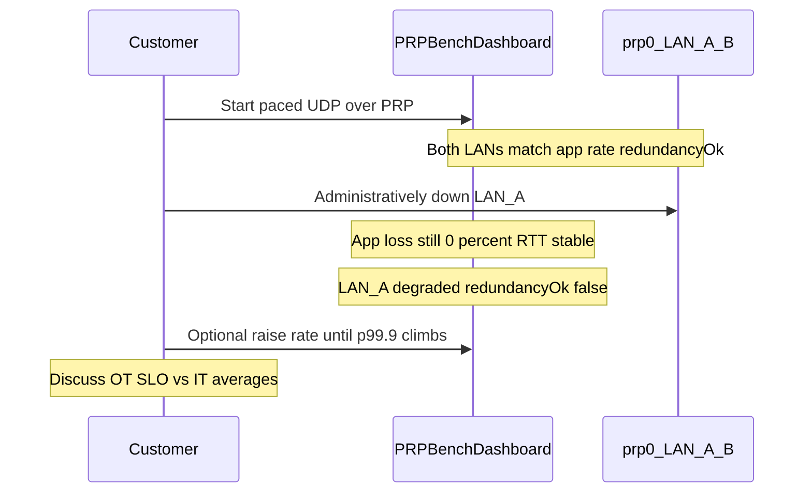

# Demo: Silent PRP LAN Failure

**Audience:** Industrial Edge, DCS, OT, and OPC-UA customer conversations  
**Goal:** Show that PRP hides a single LAN failure from the application — and that this tool still makes the loss of **redundancy** visible.

This is the primary customer demo for PRP on the edge: application loss can stay ~0% while redundancy is gone. Full ops detail lives in the [README](../README.md) (*Host and PRP link metrics*).

---

## Talk track (keep it short)

1. OT cannot wait for RSTP — PRP gives **zero failover** by sending every frame on two LANs and keeping the first copy.
2. Watch **loss + RTT + both LAN rates** agree on a healthy run.
3. Pull a cable / disable a slave — the **app stays green**; **redundancy** does not.
4. Optional: raise rate until p99.9 climbs — discuss bufferbloat vs loss (OT SLOs vs IT averages).
5. Roadmap: same underlay can carry OPC-UA PubSub–shaped traffic ([plan](opcua-pubsub-synth-plan.md)); today the load is unicast UDP.

**Do not claim:** IEC 62439-3 (PRP/HSR) implementation or certification, or that
this run is real GOOSE/SV/OPC-UA. The demo shows *benefits of* a 62439-3 PRP
underlay under application load — the standard itself is implemented by the
network stack, not by this tool. See the README section *IEC 62439-3 (PRP / HSR)*.

---

## Prerequisites

- Sender and receiver running over a working PRP link (`prp0` with two slaves), as in the README architecture diagram.
- Dashboards reachable on both ends (HTTP `:8080`), or at least the sender (peer panel helps).
- Ability to **administratively down** or physically disconnect **one** slave NIC on the path under test (receiver side is clearest for RX rates).

---

## Steps

### 1. Baseline — redundancy healthy

1. Start a paced run (dashboard **Apply & Restart**, or `POST /api/stats/start`). Use a moderate rate first (for example 5,000–8,000 msg/s) so the story is about redundancy, not overload.
2. On the **Host & PRP link** panel, confirm a three-way agreement:

```
app-level rate     ≈ configured target
LAN A (slave)      ≈ same pkt/s
LAN B (slave)      ≈ same pkt/s
redundancyOk       = true
```

3. Note app **loss ~0%** and a sane RTT p50 (milliseconds, not seconds).

If the two LAN rates do not match the app rate, fix the underlay before continuing — the failure demo only lands if the baseline is clean.

### 2. Fail one LAN

1. On the receiver host (or the switch port toward one slave), disable **one** PRP slave interface, for example:

```bash
# Example only — use your real slave names from the dashboard (enp6s0 / enp7s0, etc.)
sudo ip link set <slave-lan-a> down
```

2. Keep the load running. Do **not** restart the pods.

### 3. What you should see

| Signal | Expected |
|--------|----------|
| App loss % | Still ~**0%** (other LAN still delivers every frame) |
| RTT / jitter | Roughly unchanged at moderate load |
| Failed LAN rx rate | Drops; panel marks **degraded** |
| Surviving LAN rx rate | Still ≈ app rate |
| `redundancyOk` | **false** |

**The point for the customer:** a tool that only reported application loss would call this run perfect. You are now on a protocol chosen for redundancy, with **no** redundancy left — and the Host & PRP panel is what catches it.

### 4. Restore

1. Bring the slave back up:

```bash
sudo ip link set <slave-lan-a> up
```

2. Within a few sample intervals (panel updates about once per second), both LAN rates should track again and `redundancyOk` return to **true**.

### 5. Optional — stress vs SLO

1. From the sender dashboard, raise messages/sec until **RTT p99.9** climbs while loss may still be 0%.
2. Talk track: zero loss with multi-second queueing delay still fails an OT deadline (see README *Interpreting packet loss* / bufferbloat table).
3. Optionally show `iperf3` on the same path ([`k8s/tools/iperf3.yaml`](../k8s/tools/iperf3.yaml)) if someone asks whether the ceiling is the JVM or the link.

---

## Storyboard



---

## Troubleshooting

| Symptom | Likely cause |
|---------|----------------|
| App loss jumps when one LAN fails | Not true PRP path, or both legs affected; check `prp0` / cabling |
| Both LAN rates die | You took down the wrong interface or the PRP master |
| `redundancyOk` never false | Traffic too low (`busiest > 10` pkt/s needed); or slaves not discovered (`PRP_BENCH_PRP_INTERFACE`) |
| RTT already seconds before failure | Overload / bufferbloat — lower rate for the redundancy story first |

Kernel-first checks: README *Interpreting packet loss*.
