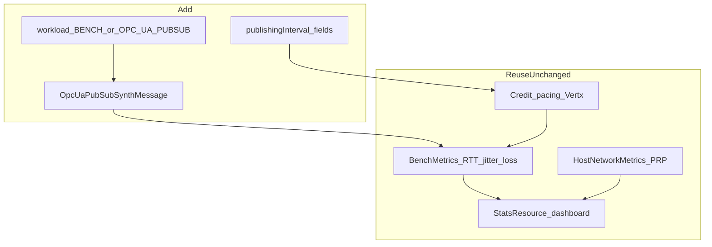

# Plan: Synthetic OPC-UA PubSub Workload

Status: **planned** (not implemented yet)

This document captures the agreed design for adding an OPC-UA PubSub–**shaped** UDP workload to PRP Bench. It reuses the existing sender/receiver pacing, metrics, dashboard, and PRP host counters. A full OPC-UA stack (e.g. Eclipse Milo) is out of scope for this phase.

The project [README](../README.md) states clearly that **OPC-UA is roadmap, not shipped**: today’s data path is unicast UDP for PRP measurement. Do not demo this plan as if the synth workload already exists. The same README clarifies that this project does **not** implement or certify **IEC 62439-3**; it only exercises and observes a PRP underlay.

**Follow-up (done, internal):** PRP/HSR demonstration & stress grading informed the README positioning and [demo-prp-lan-failure.md](demo-prp-lan-failure.md). The grade write-up itself is kept local and is not published in this repo.

---

## Decision

Ship workload profile **`OPC_UA_PUBSUB`** alongside the current default **`BENCH`**.

| Profile | Meaning |
|---------|---------|
| `BENCH` | Current behaviour: opaque UDP with `[seq][senderNanos][payload]` |
| `OPC_UA_PUBSUB` | Synthetic UADP-**shaped** NetworkMessages (educational / stress). **Not** wire-interoperable with real OPC-UA PubSub subscribers |

Industrial defaults for `OPC_UA_PUBSUB`:

- **Publishing interval:** 100 ms → 10 NetworkMessages/s
- **Dataset:** 10 fields × 8 bytes
- Plus a small fixed synthetic header

Rates and sizes remain configurable so the same path can still stress PRP at higher loads.

---

## Why OPC-UA fits PRP and Industrial Edge

- **Interoperability at the edge:** OPC-UA is the common IT/OT bridge (PLCs, gateways, MES, cloud connectors) on industrial OpenShift/Kubernetes edges.
- **PRP is L2:** Any Ethernet payload on `prp0` benefits—including PubSub UDP and (later) TCP client/server sessions.
- **PubSub + PRP is the natural pairing:** Cyclic, often loss-sensitive traffic; acceptance criteria match this tool (zero loss, p99.9 latency, stable jitter)—see the README *Why zero loss matters here*.
- **Client/Server TCP** still benefits from PRP at L2, but needs a different stack and metrics; **out of scope** here.
- **Complements GOOSE/SV:** Keep IEC 61850-style stress while adding an Industry 4.0–recognisable information-model / middleware **shape**.

---

## What we reuse



| Existing piece | Role for OPC-UA synth |
|----------------|----------------------|
| Dual mode (`SENDER` / `RECEIVER`) | Publisher / subscriber roles |
| Credit pacing + Vert.x UDP | Cyclic publish loop |
| `BenchMetrics` (loss, RTT, jitter, throughput) | Unchanged measurement semantics |
| `HostNetworkMetrics` + PRP LAN health | Silent single-LAN failure still visible |
| REST + dashboard + Prometheus | Same control / observe plane |
| k8s `hostNetwork` + TuneD | Same underlay |

---

## Configuration

Extend `BenchConfig` and `application.properties` (env prefix `PRP_BENCH_` / `PRP_BENCH_OPCUA_*`):

| Property | Default | Meaning |
|----------|---------|---------|
| `prp-bench.workload` | `BENCH` | `BENCH` or `OPC_UA_PUBSUB` |
| `prp-bench.opcua.publishing-interval-ms` | `100` | Cyclic publish period when workload is `OPC_UA_PUBSUB` |
| `prp-bench.opcua.publisher-id` | `1` | Synthetic PublisherId in header |
| `prp-bench.opcua.field-count` | `10` | Dataset field count |
| `prp-bench.opcua.field-bytes` | `8` | Bytes per field |

When `OPC_UA_PUBSUB` is active:

- Derive `messagesPerSecond ≈ 1000 / publishingIntervalMs` (integer, minimum 1), unless overridden via the existing start API.
- Derive payload from `fieldCount × fieldBytes`, unless overridden.
- Keep ports **9200** (data) / **9201** (ACK) / **8080** (HTTP).

---

## Wire format (synthetic, non-interoperable)

New class `OpcUaPubSubSynthMessage` (name may vary slightly in implementation):

```
[1B version=1][1B flags][2B reserved]
[4B publisherId][4B sequence]
[8B senderNanos]
[NB dataset payload = fieldCount * fieldBytes]
```

- Sequence + `senderNanos` preserve today’s loss and RTT paths (ACK still echoes `senderNanos`).
- Version / flags / publisherId make the shape recognizable in docs and hex dumps.
- This is **not** a real OPC-UA PubSub UADP NetworkMessage. Real stacks will not decode it.

`PrpMessage` remains the codec for `BENCH`.

---

## Implementation outline

1. **Config** — `workload` enum + nested opcua settings in [`BenchConfig.java`](../src/main/java/com/redhat/prpbench/BenchConfig.java) and [`application.properties`](../src/main/resources/application.properties).
2. **Codec** — `OpcUaPubSubSynthMessage` encode/decode; branch in [`SenderService.java`](../src/main/java/com/redhat/prpbench/SenderService.java) / [`ReceiverService.java`](../src/main/java/com/redhat/prpbench/ReceiverService.java).
3. **API** — [`StatsResource.java`](../src/main/java/com/redhat/prpbench/StatsResource.java): expose `workload` + opcua fields; optional `publishingIntervalMs` on start for PubSub profile.
4. **UI** — [`index.html`](../src/main/resources/META-INF/resources/index.html): workload badge; publish-interval / field labels when in `OPC_UA_PUBSUB`.
5. **k8s** — Document example env (`PRP_BENCH_WORKLOAD=OPC_UA_PUBSUB`) on sender/receiver manifests.
6. **Docs** — README section on synthetic PubSub + OPC-UA/PRP rationale; short note in [`student-guide-tanenbaum.md`](student-guide-tanenbaum.md).

---

## Acceptance criteria

- `WORKLOAD=BENCH`: behaviour unchanged (same header and defaults).
- `WORKLOAD=OPC_UA_PUBSUB`: synth header on the wire; API/dashboard show workload; loss / RTT / jitter / PRP host metrics still work; default ~10 msg/s at 100 ms with default fields.
- Documentation states clearly: **not interoperable** with real OPC-UA PubSub.

---

## Out of scope (this phase)

- Eclipse Milo / real UADP or OPC-UA TCP client/server
- UDP multicast (keep unicast `target-host`; multicast later)
- Security (Sign/Encrypt), discovery, address space / information models
- **HSR-specific** tooling (README documents the caveat; lab validation still required)

---

## Follow-up: PRP / HSR compliance grading

**Done (internal only).** Outcomes landed in the README (*What this is / is not*, HSR note) and [demo-prp-lan-failure.md](demo-prp-lan-failure.md). The full grade document is gitignored and not published.
