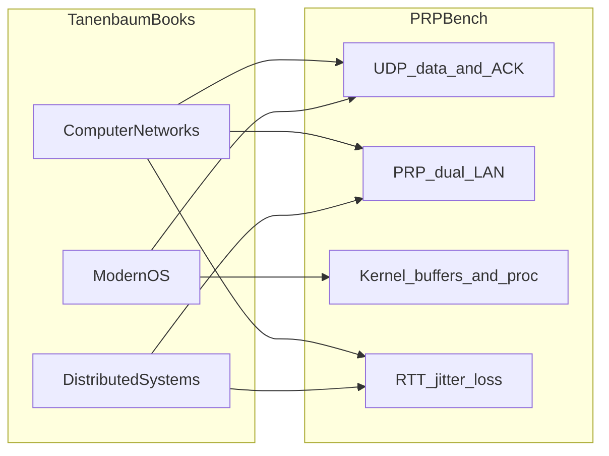

# Student Guide: PRP Bench and Tanenbaum’s Books

This guide is for IT / Computer Science students. It explains **how PRP Bench works** and connects its design to topics you meet in Andrew S. Tanenbaum’s textbooks — especially *Computer Networks*, *Modern Operating Systems*, and *Distributed Systems*.

For deployment, dashboards, and operational debugging, use the project [README](../README.md). This document stays conceptual: theory ↔ code.

For a hands-on “fail one LAN” walkthrough (Industrial Edge demo), see [demo-prp-lan-failure.md](demo-prp-lan-failure.md). The README states what this tool fairly claims today versus roadmap (OPC-UA, HSR).

**Books referenced (common IT-degree editions):**

| Book | Authors | Themes used here |
|------|---------|------------------|
| *Computer Networks* | Tanenbaum & Wetherall | Layers, UDP vs TCP, delay/loss/jitter, redundancy |
| *Modern Operating Systems* | Tanenbaum & Bos | Processes vs event I/O, sockets, kernel buffers, `/proc` |
| *Distributed Systems* | Tanenbaum & Van Steen | Failure models, clocks, sampling, observability |

We cite **topics and chapter themes**, not long quotations. Open your edition and search the index for the italicized keywords below.

*Further reading:* *Structured Computer Organization* (Tanenbaum) is less central here; skim it only if you want the hardware layering story behind NICs and buses.

---

## 1. What is PRP Bench?

**PRP Bench** is a small Quarkus / Vert.x application that **benchmarks a UDP path over a Parallel Redundancy Protocol (PRP) link**. PRP is specified in **IEC 62439-3**, but this application does **not** implement or certify that standard — the kernel/NIC provide `prp0`; the bench only drives and measures traffic on top. It runs as either a **sender** or a **receiver** and reports:

- Offered / achieved **throughput** (Mbit/s)
- **Packet loss** (gaps in sequence numbers)
- **Round-trip time (RTT)** with percentiles (p50, p95, p99, p99.9)
- **Inter-arrival jitter**
- **Host / kernel** UDP errors and **per-LAN** counters (PRP redundancy health)

PRP sends every frame on **two independent LANs** at once. The receiver keeps the first copy and drops the duplicate, so failover time is **zero**. That matters in operational technology (OT) networks (for example IEC 61850 protection traffic), where retransmission and multi-second reconvergence are not acceptable.

**Important scope notes:**

- This bench drives **unicast UDP**. Real GOOSE/SV are often **multicast**; the README uses them as motivation for *what to measure*, not as a claim that the tool speaks those protocols.
- **HSR** (ring-based seamless redundancy in the same IEC 62439-3 family) is related in spirit but **not** a first-class story here — default device is `prp0`. Treat HSR demos as unverified until your lab validates `hsr0`.

**Acceptance criteria differ from typical IT benchmarks.** Average throughput alone is almost irrelevant. What matters is zero loss at the offered rate, bounded worst-case latency (p99.9), and low, stable jitter. See the README section *Why zero loss matters here*.

---

## 2. System picture

One binary, two modes (`SENDER` / `RECEIVER`), usually on two hosts that share a PRP link (`prp0`):

```
   Host A (sender)                                    Host B (receiver)
  ┌─────────────────────┐                             ┌─────────────────────┐
  │       SENDER        │ ──── UDP data :9200 ──────► │      RECEIVER       │
  │   paced send loop   │ ◄─── UDP ACK  :9201 ─────── │   counts + ACKs     │
  └──────────┬──────────┘                             └──────────┬──────────┘
             │                                                   │
          ┌──┴──┐          LAN A                              ┌──┴──┐
          │prp0 ├─────────────────────────────────────────────┤prp0 │
          │     ├─────────────────────────────────────────────┤     │
          └─────┘          LAN B                              └─────┘
```

| Plane | Port | Protocol | Role |
|-------|------|----------|------|
| Data | `9200` | UDP | Benchmark packets (sequence + timestamp + payload) |
| Measurement | `9201` | UDP | Sampled ACKs carrying the sender’s timestamp back |
| Control / UI | `8080` | HTTP | REST stats, dashboard, Prometheus `/q/metrics` |

Defaults live in [`application.properties`](../src/main/resources/application.properties) and [`BenchConfig.java`](../src/main/java/com/redhat/prpbench/BenchConfig.java) (override with `PRP_BENCH_*` env vars).



---

## 3. How a packet travels (code walk)

All application logic sits in one package: `com.redhat.prpbench`.

### 3.1 Wire format

[`PrpMessage.java`](../src/main/java/com/redhat/prpbench/PrpMessage.java) defines a 16-byte header plus optional payload:

```
[ 8 bytes sequence ][ 8 bytes senderNanos ][ N bytes payload ]
```

The sequence number supports loss detection. The sender’s `System.nanoTime()` value is echoed in ACKs so the sender can compute RTT without synchronized wall clocks.

### 3.2 Sender

[`SenderService.java`](../src/main/java/com/redhat/prpbench/SenderService.java):

1. Activates only if `prp-bench.mode=SENDER`.
2. Binds a UDP socket and **listens for ACKs** on the ack port.
3. Starts a Vert.x **1 ms periodic timer** with **credit-based pacing** (`rate / 1000` packets per tick, carrying fractional remainder) so the offered load matches the configured rate.
4. Each packet: encode with `PrpMessage.encode(seq, nanoTime, payload)` → `socket.send` to `targetHost:dataPort`.
5. On ACK: `recordRtt(now - echoedSenderNanos)`.

### 3.3 Receiver

[`ReceiverService.java`](../src/main/java/com/redhat/prpbench/ReceiverService.java):

1. Activates only if `mode=RECEIVER`.
2. Listens on the data port; on each datagram, records sequence and size.
3. Sends an ACK every `ackSampleRate` packets (default **100**), echoing the original `senderNanos` with an empty payload.

### 3.4 Metrics

| Class | Role |
|-------|------|
| [`BenchMetrics.java`](../src/main/java/com/redhat/prpbench/BenchMetrics.java) | Counters; loss = `highestSeq - firstSeq + 1 - received`; RTT / jitter percentiles; discard absurd RTTs (> 10 s) |
| [`ThroughputReporter.java`](../src/main/java/com/redhat/prpbench/ThroughputReporter.java) | Once per second, Mbit/s from byte deltas |
| [`HostNetworkMetrics.java`](../src/main/java/com/redhat/prpbench/HostNetworkMetrics.java) | `/proc/net/snmp` (UDP RcvbufErrors) and per-LAN `/sys/class/net/.../statistics` |

Jitter is measured every packet (inter-arrival delta) but only **1 in 100** samples enter the histogram — histogram updates are expensive on the hot path.

### 3.5 Control plane

[`StatsResource.java`](../src/main/java/com/redhat/prpbench/StatsResource.java) exposes HTTP under `/api/stats` (start/stop, JSON stats, peer proxy). That path is **monitoring and control**, not the UDP data plane.

---

## 4. Curriculum map — *Computer Networks*

| Textbook theme | What to look up | How PRP Bench embodies it |
|----------------|-----------------|---------------------------|
| **Protocol layers** | OSI / TCP-IP stack; *physical*, *data link*, *transport*, *application* | UDP is the transport. PRP sits at the **link / host network device** (`prp0` + two slave NICs). HTTP on `:8080` is a separate application channel for stats. |
| **Connectionless vs connection-oriented** | *UDP*, *TCP*, reliability | The bench uses **UDP** like much OT traffic (multicast GOOSE / Sampled Values style constraints). There is **no TCP retransmission** on the data path; loss is visible as sequence gaps. |
| **End-to-end argument / reliability** | Where to put reliability | PRP provides **spatial redundancy** (send twice, keep first) rather than **temporal** recovery (retransmit later). Zero failover time vs RSTP-style reconvergence. |
| **Delay components** | Transmission, propagation, queuing, processing delay | RTT percentiles (`prp.rtt`) and jitter (`prp.jitter.us`) separate “typical” from “tail” delay. Queuing shows up as rising RTT long before the app reports loss. |
| **Packet loss** | Congestion, buffer overflow, bit errors | App loss uses sequence range math in `BenchMetrics.getLost()`. Kernel `RcvbufErrors` can show loss the application never saw. |
| **Redundancy and failover** | Link aggregation, spanning tree, multipath | Dual LAN under PRP: if one LAN dies, **application loss can stay 0%**. Only comparing the two slave interfaces exposes the failure — see §6 and `HostNetworkMetrics`. |

**OT vs IT takeaway:** In many IT labs you optimize for goodput and “four nines.” Here, a single late or lost frame can miss a hard deadline. That is why the tool emphasizes **percentiles and zero loss**, not average Mbit/s alone.

---

## 5. Curriculum map — *Modern Operating Systems*

| Textbook theme | What to look up | How PRP Bench embodies it |
|----------------|-----------------|---------------------------|
| **Processes and concurrency** | Threads, events, race conditions | UDP handlers and the 1 ms send timer run on the **Vert.x event loop** (async I/O), not a thread-per-packet pool. Counters use atomics for safe concurrent updates. |
| **I/O and sockets** | Socket API, datagram sockets | `DatagramSocket` (Vert.x / Netty) for send and receive. Bind address and ports come from config. |
| **Kernel buffering** | Socket buffers, `SO_RCVBUF`, memory copying | Default `receiveBufferBytes=0` leaves sizing to the kernel (`net.core.rmem_*`). The README/`BenchConfig` warn that a large app-side value also sizes Netty’s **per-read** buffer and can destroy throughput. |
| **OS interfaces to the network stack** | `/proc`, sysctl, device drivers | `HostNetworkMetrics` reads `/proc/net/snmp` and `/sys/class/net`. Node tuning (`k8s/node-tuning.yaml`) raises `rmem_*` and `netdev_max_backlog` — classic OS-level network tuning. |
| **Virtualization / containers** | Namespaces, isolation | Pods often use `hostNetwork: true` so the process sees the **host** network namespace (and thus host `prp0` and `/proc`). That is a deliberate trade: observability over full network isolation. |

**Student experiment (conceptual):** If the receive socket buffer is too small for the offered rate, the kernel drops datagrams (`RcvbufErrors`) while the application’s “lost” counter may lag or disagree until you compare both signals — a concrete instance of **where loss is counted** in the OS vs the app.

---

## 6. Curriculum map — *Distributed Systems*

| Textbook theme | What to look up | How PRP Bench embodies it |
|----------------|-----------------|---------------------------|
| **What is a distributed system?** | Independent computers cooperating | Two JVMs on two hosts, coordinated only by UDP + optional HTTP. No shared memory. |
| **Failure models** | Crash, omission, partial failure | **Partial failure:** one PRP LAN can fail while the other still delivers every frame. App metrics look perfect; redundancy is gone. `redundancyOk` / `LAN DEGRADED` (a slave below half the rate of the busier LAN, once traffic is present) is the detection mechanism. |
| **Clocks and time** | Logical vs physical clocks, RTT estimation | RTT uses the **same machine’s** `nanoTime` echoed in the ACK — no need for synchronized clocks between hosts. Implausible deltas (e.g. after restart) are discarded so they do not poison histograms. |
| **Measurement and sampling** | Overhead vs accuracy | ACK every N packets; jitter histogram 1/100. More samples → better statistics, more CPU and reverse-path load. |
| **Observability** | Monitoring vs the service itself | REST + Prometheus + dashboard observe the system; they must not be confused with the real-time UDP path that OT traffic would use. |

**Classic lesson:** In distributed systems, **“the application says OK” is not enough.** Masked redundancy loss is exactly the kind of silent degradation textbooks warn about under partial failure.

---

## 7. Study questions

Answer these from the code and your Tanenbaum chapters (no need to run a lab for most of them):

1. **UDP vs TCP.** Why does a tool that *measures* reliability still send data over UDP? What would change if the data path used TCP instead?
2. **Sequence numbers.** Write the loss formula used in `BenchMetrics.getLost()` in your own words. Why does it anchor on `firstSeqSeen` instead of assuming sequences start at zero?
3. **PRP redundancy.** Explain how application loss can stay 0% while one LAN is dead. Which counters would move?
4. **Queuing delay.** A run shows 0% loss but RTT p99.9 in the hundreds of milliseconds. Which delay component is the likely culprit, and where in the stack might packets be waiting?
5. **Event loop vs threads.** How does Vert.x’s 1 ms timer + credit pacing relate to OS scheduling and “honest” offered load?
6. **Kernel vs app buffers.** Why does the project prefer TuneD/`sysctl` over setting a huge `PRP_BENCH_RECEIVE_BUFFER_BYTES`?
7. **Clocks.** Why can RTT be computed without NTP between sender and receiver? When would an RTT sample be thrown away?
8. **Control vs data plane.** List which ports belong to the measurement data path and which belong to management. Why does that separation matter in a real plant network?

---

## 8. Where to go next

1. Skim the [README](../README.md) architecture diagram and *Host and PRP link metrics* section (same ideas, operational detail).
2. Read in this order in the repo:
   - [`PrpMessage.java`](../src/main/java/com/redhat/prpbench/PrpMessage.java) — wire format (smallest file)
   - [`SenderService.java`](../src/main/java/com/redhat/prpbench/SenderService.java) — pacing and RTT
   - [`HostNetworkMetrics.java`](../src/main/java/com/redhat/prpbench/HostNetworkMetrics.java) — OS + PRP visibility
3. Revisit Tanenbaum: *Computer Networks* (UDP, delay, redundancy), *Modern Operating Systems* (sockets, buffering), *Distributed Systems* (partial failure, time).

If you deploy the stack, treat the dashboard screenshots in this folder ([`dashboard-sender.png`](dashboard-sender.png), [`dashboard-receiver.png`](dashboard-receiver.png)) as a checklist: app rate, peer loss, and both LAN rates should agree on a healthy PRP link.
